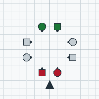

<!-- nav:start -->
**[⏮](../index.md "Previous section: Front matter") [◀](what-is-square-dancing.md "Previous page: What square dancing is") [☰](../contents.md "Contents") [▶](your-first-call.md "Next page: Your first call — Circle Left") [⏭](../02-language/naming-the-dancers.md "Next section: The language")**
<!-- nav:end -->

# The square

## Eight dancers, four couples

A square is **eight dancers** in **four couples**. The couples stand on the four sides of the
square, each couple side by side, facing inwards.

The innermost part of the floor — a two-dancer-wide cross through the middle — stays clear. Almost
every call is people walking into that space, doing something in it, and coming back out to a
place. Because the middle is where the work happens, most calls are described in terms of it.

## The four positions

Stand in the square and look around. The four couples occupy the four **positions**: north, south,
east and west of the centre. Each position is home to one couple for the whole tip.

Couples are numbered **1, 2, 3 and 4**. Couple 1 is the couple whose back is to the caller, and the
numbers then run to Couple 1's right: 2, 3, 4, all the way round. See
[Couples and positions](../02-language/couples-and-positions.md).

## Heads and Sides

The two couples facing toward or away from the caller are the **Heads**. The two couples standing
perpendicular — across the hall — are the **Sides**.

Heads and Sides is the oldest way of saying "these four dancers" and it is still the most common
one. The identity is carried by the **Boys**: a Boy keeps the one he squared up with all the way
through the tip, even if he finishes up standing in somebody else's position, and the Girl with him
counts as whatever he is — so a Girl's identity changes whenever she changes partner.

Full detail, including the tricky cases, is in
[Naming the dancers](../02-language/naming-the-dancers.md).

## Boys and Girls

Within a couple, the dancer who squared up on the **left** is a **Boy**; the dancer on the **right**
is a **Girl**.

This is a *role*, not a statement about who you are. The manual is explicit: whatever the actual
genders in the square, the left-side dancer plays the Boy's part and the right-side dancer plays
the Girl's part. Modern teaching and choreography mostly avoid gender entirely, and where a call
does depend on it, it is because the call needs *four particular dancers*.

Older material — and many callers — say **Men and Women**, or **Gents and Ladies**. Both are the
same thing. This book teaches the 2026 words.

## Couples: proper and improper

A couple standing side by side is **Normal** when the Boy is on the left and the Girl on the right.
When the Girl is on the left, the couple is **Sashayed** (or Half-Sashayed — you will hear both).

The distinction matters because a Normal Couple is the starting formation for several calls. See
[Arrangements and gender](../02-language/arrangements-and-gender.md).

## At home

When the square is arranged as it was when you started — every couple in its own position, facing
in, everyone in sequence — dancers say they are **at home**, or that the square is a **Static
Square**. It is the resting state, and every tip returns to it.

The distinction between "a Static Square" (the arrangement) and "Squared Set" (that arrangement
*in a particular state of sequence*) is a real one, and it is explained in
[Sequence and relationship](../02-language/sequence-and-relationship.md).

## Next

- why anyone cares which way the square is facing → [Directions](../02-language/directions.md)
- the shapes the eight of you make → [Formations](../02-language/formations.md)
- a call to try → [Your first call](your-first-call.md)
