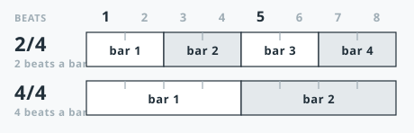

<!-- nav:start -->
**[⏮](../index.md "Previous section: Front matter") [◀](how-a-call-works.md "Previous page: How a call works") [☰](../contents.md "Contents") [▶](tips-and-figures.md "Next page: Tips, the unit of the dance") [⏭](../02-language/naming-the-dancers.md "Next section: The language")**
<!-- nav:end -->

# Timing and music

Square dancing is danced **to the music**, not at a pace of its own. Every call has a beat cost,
the caller counts those beats, and the eight of you are expected to arrive at the end of the call
on the beat.

## The beat

Standard hoedown and singing-call tempo is about **128 beats per minute**. You do not need to count;
you need to *walk* at that speed, which is a comfortable walking pace with some spring in it.

Every call's timing is given in this book in **beats**. Examples from the program:

| Call | Beats |
|---|---|
| [Pass Thru](../04-calls/m07-pass-thru.md) | 2 |
| [Star Thru](../04-calls/m18-star-thru.md) | 4 |
| [Right and Left Thru](../04-calls/m10-right-and-left-thru.md) | 6 |
| [Square Thru 4](../04-calls/m21-square-thru.md) | 10 |
| [Grand Square](../04-calls/m23-grand-square.md) | 32 |
| Circle Left, full turn | 16 |

Notice how much they vary. Grand Square is not a long move; it is a move that takes a long time
because everyone does four separate parts.

## Phrases

Music comes in **phrases**, and a phrase is **8 beats**, with the strong beats on 1 and 5. Count it in
beats rather than in bars: most square dance music is written in 2/4, where a bar is two beats and a
phrase is four of them, but 4/4 marches are used as well — and some hoedowns with them — where the same
8 beats are two bars. The phrase is the unit a caller counts in either way.

A [Star Thru](../04-calls/m18-star-thru.md) takes 4 beats — half a phrase — which is why a caller can
slip one in without disturbing anyone's feet: it *fits*. A 32-beat call needs four phrases, so where it
begins matters; [Grand Square](../04-calls/m23-grand-square.md) is the manual's own worked example.

## The 64-beat segment

A standard singing-call segment is **64 beats**: eight 8-beat phrases. Dancers feel this as the shape of
a verse.

This matters to callers rather than to dancers, but it is worth knowing because it explains why a
figure is danced **four times** in a singing call — once with each couple leading — and why the
music, once you know it, tells you when the figure is about to repeat.

## Why timing is in the definition

The manual's timing numbers are not decoration. They are the standard every caller works from, and
they are how a caller knows whether a sequence will fit the music before calling it.

Two of them behave differently and are worth flagging:

- **Promenade** has a *variable* length. Its timing is a simplification: a promenade's true duration
  is how far the set has to travel. The manual says so rather than pretending otherwise.
- **Calls that move into the middle from a squared set** cost 2 beats **extra** to get there, because
  the dancers have to walk in first. See [Squared Set Convention](../03-rules/squared-set-convention.md).

## For the caller and the teacher

Timing is the tool that makes a tip feel smooth. If a figure feels rushed, the answer is almost never
"dance faster" — it is to call the calls with the timing the manual gives them, and let the dancers
use the beats they have.

The numbers for every call in this book are collected in
[the call index](../08-reference/call-index.md).

None of it works without music that keeps its phrases in the same places: a record that drifts, or
drops a bar, cannot be called to however carefully the figures are timed. What to look for in a record,
and where square dance music comes from, is [Finding music](../06-practice/finding-music.md).

## Next

- how calls are combined into a whole dance → [Tips, the unit of the dance](tips-and-figures.md)
- what a fraction means → [Fractions](../02-language/fractions.md)
