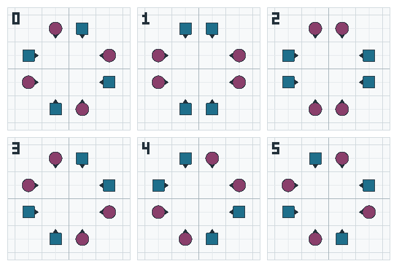

<!-- nav:start -->
**[⏮](../01-start/what-is-square-dancing.md "Previous section: Start here") [◀](formations.md "Previous page: Formations") [☰](../contents.md "Contents") [▶](sequence-and-relationship.md "Next page: Sequence and relationship") [⏭](../03-rules/passing-rule.md "Next section: The rules")**
<!-- nav:end -->

# Arrangements and gender

Within a formation, it is not only *where* the dancers are that matters, but **which dancer** is at
each spot. That pattern is the **arrangement**, and it is why the same call can work from one
squared set and fail from another.

## The three couple arrangements

| Arrangement | What it is |
|---|---|
| **Normal Couple** | a Boy on the left, a Girl on the right |
| **Sashayed Couple** (Half-Sashayed) | a Girl on the left, a Boy on the right |
| **Same-Gender Couple** | two Girls, or two Boys |

The manual notes that "Sashayed" is technically short for half-sashayed, and both words are in use.

## Why it matters

Several Mainstream calls are defined to start **only from a Normal Couple**. The most important is
[**Courtesy Turn**](../04-calls/m09-courtesy-turn.md), and because
[Right and Left Thru](../04-calls/m10-right-and-left-thru.md) and
[Chain Down the Line](../04-calls/m12-ladies-chain-family.md) both contain a Courtesy Turn, those are
restricted too.

The Plus manual records exactly this when it says which Mainstream restrictions are removed at Plus:

> "Courtesy Turn: In the Mainstream Program, Courtesy Turn can start only from a Normal Couple.
>  At Plus this restriction is removed."

This is one of the most useful facts in this book for a beginner, because it explains a whole class
of "why did that go wrong?" — you were not in a Normal Couple.

## Arrangement and the whole square

An arrangement is a property of the whole set, not just of one couple. In a squared set where every
couple is Normal, the square is "in proper arrangement". After a few calls the couples may be
mixed — one Normal, one Sashayed — and the caller chooses calls that work with what is actually there.

A squared set can be in **six** arrangements, and callers number them 0 to 5:

| Number | The four couples |
|---|---|
| **0** | every couple Normal — home |
| **1** | the Heads all Boys, the Sides all Girls |
| **2** | the Heads all Girls, the Sides all Boys |
| **3** | the Heads Normal, the Sides Half-Sashayed |
| **4** | the Heads Half-Sashayed, the Sides Normal |
| **5** | every couple Half-Sashayed |

Two of the six leave the square with no Boy-Girl couple in it at all — numbers 1 and 2, where every
couple is a [same-gender couple](#the-three-couple-arrangements) — and the other four mix the two
kinds of couple.

The numbers are the callers' own, and an arrangement number is worked out **per formation**: the same
six numbers name different patterns in a wave or a line, so these six belong to the squared set.
*Heads* and *Sides* in the table are the names from [Naming the dancers](naming-the-dancers.md): the
Heads are the two couples in line with the caller.

## Gender is a role

The 2026 manual is careful about this, and so is this book:

- The **Boys** are the dancers who squared up on the **left** of each couple.
- The **Girls** are the dancers who squared up on the **right**.

Whatever the actual people in the square, those are the roles. "Men", "Gents", "Gentlemen" and "Guys"
mean Boys; "Women", "Ladies" and "Gals" mean Girls. The manual also notes that callers avoid "Men"
and "Women" precisely because the words are easy to mishear.

And, importantly:

> "In modern teaching, choreography, and patter, most calls are defined without reference to gender.
> The references to gender are mostly used to designate four active dancers."

So when a caller says "Boys Run", it does not mean "the men run". It means "the four dancers who are
in the Boys' roles run". A same-gender square still dances it.

## Sequence, which is different again

Arrangement is *who is at which spot*. **Sequence** is *whether it is your turn* — a separate idea,
and a subtle one. It has its own page: [Sequence and relationship](sequence-and-relationship.md).

## Next

- holds that depend on the arrangement → [Hands and holds](hands-and-holds.md)
- an arrangement call in practice → [Courtesy Turn](../04-calls/m09-courtesy-turn.md)
