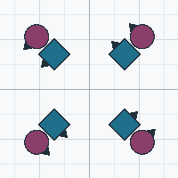

<!-- nav:start -->
**[⏮](../01-start/what-is-square-dancing.md "Previous section: Start here") [◀](couples-and-positions.md "Previous page: Couples and positions") [☰](../contents.md "Contents") [▶](formations.md "Next page: Formations") [⏭](../03-rules/passing-rule.md "Next section: The rules")**
<!-- nav:end -->

# Directions

Square dancing describes direction **relative to the square**, because the caller can call the same
figure from any arrangement. Four words do most of the work: **Left**, **Right**, **In** and **Out**.

## Left and Right

**Left** and **Right** always mean *from the dancer's own point of view*. If you turn left, you turn
to your own left, not to the hall's.

This is why two dancers executing the same call can end up moving in opposite compass directions and
both be right.

## In and Out — and the "flagpole centre"

The centre of the square has a name: the **flagpole centre**. It is a geometrical point, not a
physical thing, and the clear space there is where most of the dancing happens.

- **Facing in** — the centre of the set is somewhere in front of you.
- **Facing out** — the centre of the set is somewhere behind you.

The manual defines this precisely, using an imaginary line running left–right through your shoulders,
perpendicular to the way you are facing:

> "If the center of the set is anywhere in front of that left-right line, then the dancer is said to
> be 'facing in.'"

Two useful consequences:

- In a squared set, everyone is **facing in**, even before they turn to face their partner.
- If you are standing with one shoulder pointing directly at the centre — as in a promenade or a
  tidal line — then you are **neither** facing in nor facing out. The centre is exactly on your
  shoulder line, not in front of it or behind it.

## Face Left / Right / In / Out

These four are commands in their own right, and they mean **turn in place, on the spot, 90 degrees**:

| Command | What you do |
|---|---|
| **Face Left** | turn 90° to your left, in place |
| **Face Right** | turn 90° to your right, in place |
| **Face In** | turn 90° toward the centre of the set |
| **Face Out** | turn 90° away from the centre of the set |

"Face" does not mean "walk". You stay on your spot.

## Forward and Back

**Forward and Back** is a two-part movement: everyone steps toward the centre of the set, then steps
back to where they started. It appears in openers constantly — *"Circle Left, Forward and Back,
Circle Right"*.

It is one of the building blocks the manual lists under **Descriptive Terminology** rather than as a
programme call, which is why there is no call card for it here: it is vocabulary, like "Left" or
"Swing". You will still dance it in your first tip.

## Home

**Home** is your own spot in the squared set, and the facing that goes with it. "Go home", "home
position", "the square is home" all refer to it.

Dancers also distinguish:

- **Home** — your original spot and facing.
- **At home** — the whole square is arranged as it was at the start.
- **Promenade Home** — a specific call, defined as finishing on your own home spot facing in. See
  [Promenade](../04-calls/m03-promenade-family.md).

## Promenade Direction

When the square is promenading, everyone travels the same way around the square — **counter-clockwise
as viewed from above**, which is the direction you travel after an Allemande Left.

**Wrong Way Promenade** goes the other way.

## Reverse

**"Reverse"**, or **"go the other way"**, tells a circle to stop and turn in the opposite direction.
It is nearly always followed by the new direction: *"Reverse, and Circle Right"*.

## Turn 1/4, 1/2, 3/4, Full by the Left / Right

A turn of a stated fraction, in a stated direction, usually on the spot or around a joined hand. See
[Fractions](fractions.md) for the fraction vocabulary itself.

## Rear Back

**Rear Back** means walk backwards, in the formation you are in, away from the centre. It is used to
open out lines and waves.

## Next

- the shapes these directions describe → [Formations](formations.md)
- fractions of a turn → [Fractions](fractions.md)
