<!-- nav:start -->
**[⏮](../01-start/what-is-square-dancing.md "Previous section: Start here") [◀](directions.md "Previous page: Directions") [☰](../contents.md "Contents") [▶](arrangements-and-gender.md "Next page: Arrangements and gender") [⏭](../03-rules/passing-rule.md "Next section: The rules")**
<!-- nav:end -->

# Formations

A **formation** is the shape the dancers make — where everyone is standing and which way they are
facing. Every call has a starting formation and an ending formation, and getting them right is most
of the battle.

This page defines the formations the 2026 Mainstream program uses. Each one says what it looks like
and how you get into it.

## Squared Set and Static Square

The **Squared Set** is eight dancers in four couples on the four sides of a square, facing in.

A **Static Square** is the same arrangement, named as a *formation* rather than as a state of
sequence. The manual distinguishes them: the Static Square is the shape, and the Squared Set is the
shape *in sequence*. See [Sequence and relationship](sequence-and-relationship.md).

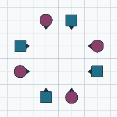
This is home, and every tip starts and finishes here.

## Circle

An **Infacing Circle of 8** is the eight of you standing in a ring, hands joined, all facing the
centre. From a squared set it takes one command — "Join hands, circle left" — and the ring then
travels round the middle of the set, left or right.

The [Circle Rule](../03-rules/circle-rule.md) says what a call starting from Facing Couples means
when it is given from a circle; the calls themselves are in
[the circle family](../04-calls/m01-circle-family.md).

## Promenade

A **Promenade** is a couple walking round the centre of the set in promenade hold — the Boy's left
hand joined to the Girl's left hand in front of the pair. The whole set travels as one stream, all
the same way round, and "Promenade Home" means stop where the Boy started.

The hold, the footwork and the timing are in
[the Promenade family](../04-calls/m03-promenade-family.md); which way round is
[promenade direction](directions.md).

## Facing Dancers

**Two dancers directly facing each other.** That is all it means, unless the call says otherwise.

Facing Dancers is the starting formation for calls like [Pass Thru](../04-calls/m07-pass-thru.md),
[Dosado](../04-calls/m02-dosado.md) and [Star Thru](../04-calls/m18-star-thru.md).

Some calls are more specific: Star Thru needs a **Boy facing a Girl**, because the call is built on
that handhold. The manual writes it as "Facing Dancers (Man facing Woman)".

## Facing Couples

**Two couples facing each other** — four dancers, two and two, in two lines facing inwards. Also
called an "Infacing Facing Couples" arrangement.

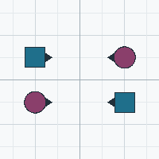
From a squared set you get there by the Heads or Sides stepping forward. It is the starting
formation for a great many calls, including
[Right and Left Thru](../04-calls/m10-right-and-left-thru.md) and
[Star Thru](../04-calls/m18-star-thru.md).

## Eight Chain Thru

An **Eight Chain Thru** is two couples facing each other with their **Boys on opposite sides** of the
pair. Because the couples are set that way rather than as mirror images, each dancer looks at a dancer
of the opposite role — Boys at Girls — instead of at their opposite number, and each pass across takes
you on to the next couple round the square.

A [Lead Right](../04-calls/m16-lead-right-lead-left.md) makes one out of a squared set, and
[Trade By](../04-calls/m39-trade-by.md) finishes in one. From there the next call is usually
[Right and Left Thru](../04-calls/m10-right-and-left-thru.md) or a
[Square Thru](../04-calls/m21-square-thru.md).

## Couple

**Two adjacent dancers facing the same way.** Not a formation you dance *from* so much as a shape
you finish in — Star Thru ends in a couple.

Variants, which matter because calls depend on them:

| Name | What it is |
|---|---|
| **Normal Couple** | Boy on the left, Girl on the right |
| **Sashayed Couple** (Half-Sashayed) | Girl on the left, Boy on the right |
| **Same-Gender Couple** | two Boys, or two Girls |
| **Tandem Couple** | a couple, one behind the other |

See [Arrangements and gender](arrangements-and-gender.md).

## Tandem

A **Tandem** is two dancers in single file — one directly behind the other, both facing the same way.
Two tandems facing each other are **Facing Tandems**; two tandems back to back are **Back-to-Back
Tandems**. The manual uses those names as the starting and ending formations of
[Double Pass Thru](../04-calls/m24-double-pass-thru.md).

A couple in single file is a **Tandem Couple**, and is the shape [Zoom](../04-calls/m41-zoom.md) and
[Dive Thru](../04-calls/m29-dive-thru.md) finish in.

## Back-to-Back Couples

**Back-to-Back Couples** are two couples standing back to back, each couple facing the couple in
front of it. [Veer Left / Veer Right](../04-calls/m17-veer-left-veer-right.md) finishes there from a
Two-Faced Line, and it is where a [Square Thru](../04-calls/m21-square-thru.md) ends.

Two dancers can be back to back in the same way, each facing away from the other — that is what you
are after a Pass Thru in [Pass the Ocean](../04-calls/m35-pass-the-ocean.md).

## Lines

Dancers in a **line** are shoulder to shoulder, in one or more rows.

| Line | What it is |
|---|---|
| **Facing Lines** | two lines facing each other, four dancers each |
| **Back-to-Back Lines** | two lines back to back |
| **Normal Lines** | lines in which every couple is Normal |
| **Lines Facing Out** | lines with the dancers facing away from each other — used by Boys Fold and Girls Fold |
| **One-Faced Lines** | all dancers in the line facing the same direction (a line, not two lines) |
| **Two-Faced Lines** | two lines back to back, each facing outward |
| **Inverted Lines** | a line with the Ends facing out and the Centers facing in |
| **Tidal Line** (Tidal Wave) | a line of eight — two facing four facing two |

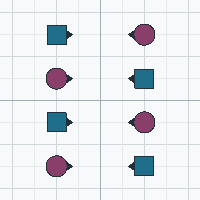
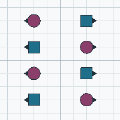
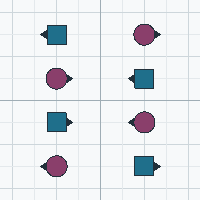
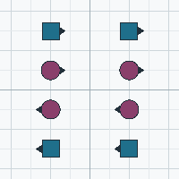
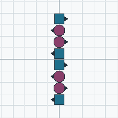
In an eight-dancer line the words "Centers" and "Ends" are ambiguous, because there are two possible
centre pairs. Callers say **"Each Side, Centers"** or **"Center Four"** to be precise. See
[Naming the dancers](naming-the-dancers.md).

## Waves

An **Ocean Wave** is a line of dancers alternating facing direction, joined by hands — typically
right hands. Dancers in a wave are **Centers** and **Ends** regardless of facing.

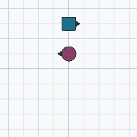
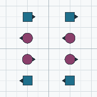
| Wave | What it is |
|---|---|
| **Right-Hand Wave** | adjacent dancers joined by right hands |
| **Left-Hand Wave** | adjacent dancers joined by left hands |
| **Mini-Wave** | a wave of two — the simplest case, two dancers facing opposite ways |
| **Ocean Wave** | a wave of four or more |
| **Tidal Wave** | a wave of eight |
| **Alamo Ring** | a ring of dancers all facing the centre, in Alamo Style |

Waves are where the [Facing Couples Rule](../03-rules/facing-couples-rule.md) and the
[Ocean Wave Rule](../03-rules/ocean-wave-rule.md) earn their keep: they let certain calls start from
the "wrong" member of the wave/facing-couples pair.

## Columns

Dancers in two or more lines of four, one behind the other, facing along the column. A column of
eight is two columns of four side by side.

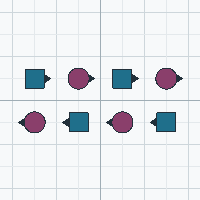
**Single File** means a column of one — the dancers in a line, one behind the other.

## Box

Four dancers in a two-by-two arrangement, most often **two couples facing each other** (a box of
four). **Leaders** face out of the box and **Trailers** face into it.

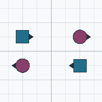
Boxes appear inside larger formations constantly; "Box Circulate" is a call about moving within one.

## Diamond

Four dancers on the four points of a diamond — a Centre and three Points, or an End and three
Centres depending on how you count. Diamonds are mostly a Plus-level formation, but you will meet
them in the Mainstream circulate family descriptions.

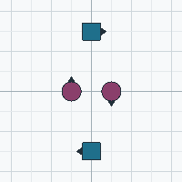
## Alamo and Thar

- **Alamo Style** — dancers in a circle, all facing the centre, holding hands in a ring. The
  starting formation for [Allemande Left in the Alamo Style](../04-calls/m31-ocean-wave-family.md).
- **Alamo Ring** — the ring formed in Alamo Style. Several calls may start from it (Swing Thru is
  one), which is why the Alamo appears in the Mainstream restrictions.
- **Thar** — an Alamo Ring with the dancers' arms crossed in the centre, so that each dancer holds a
  left forearm with one dancer and a right forearm with another. Mainly a Plus formation, but it is
  the reason a wrong-way star exists.

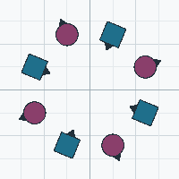
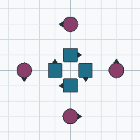
## Tag formations

A **tag formation** is what a line becomes when it is "tagged" — folded into a two-by-two box
arrangement with the dancers in a particular order. The names you will meet:

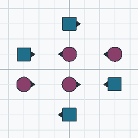
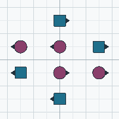
- **Quarter Tag**, **Half Tag**, **3/4 Tag** — the fraction of the tag completed
- **Center Four**, **Outside Four**, **Center 6**, **Outside 6**, **Very Centers**, **Very Ends** —
  the dancers you name in a tag formation

## Double Pass Thru

Two side-by-side [Facing Tandems](#tandem) are a **Double Pass Thru**; two side-by-side
[Back-to-Back Tandems](#tandem) are a **Completed Double Pass Thru**.

These are the two ends of the tagging sequence above — the **Zero Tag** and the **Full Tag** — so a
call that walks from one tagging formation to the next starts or finishes in one of them. See
[Double Pass Thru](../04-calls/m24-double-pass-thru.md) for the call, and
[Extend](../04-calls/m36-extend.md) for the walk between them.

## How to get into a formation you have lost

If you lose your place:

1. Look at the dancers around you and find the **shape** — a line, a wave, a box, a square.
2. Find which **position** in it is empty or over-filled.
3. Take your place, facing the way the shape requires.

The next call will straighten everything out. This is a normal part of dancing, not a failure.

## Next

- who is who within a formation → [Naming the dancers](naming-the-dancers.md)
- how to hold hands → [Hands and holds](hands-and-holds.md)
- the rules that adapt a call to a nearby formation → [03-rules](../03-rules/passing-rule.md)
