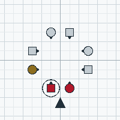
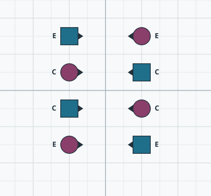
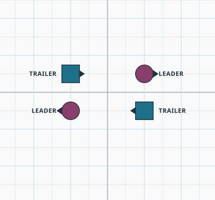
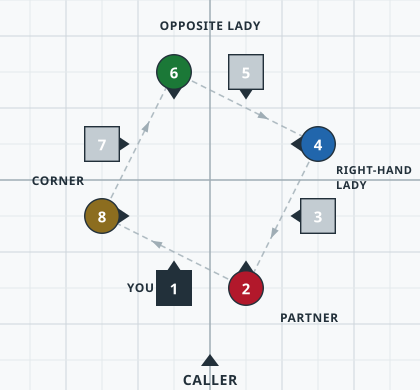

<!-- nav:start -->
**[⏮](../01-start/what-is-square-dancing.md "Previous section: Start here") [◀](../01-start/zeroes-getouts-and-modules.md "Previous page: Zeroes, get-outs and modules") [☰](../contents.md "Contents") [▶](couples-and-positions.md "Next page: Couples and positions") [⏭](../03-rules/passing-rule.md "Next section: The rules")**
<!-- nav:end -->

# Naming the dancers

A caller has to be able to say "these four dancers, not those four" in a fraction of a second. The
manual lists every way of doing it. These are the ones you will meet as a beginner.

## Partner and Corner

In a squared set, your **Partner** is the dancer beside you. Your **Corner** is the next dancer
round the nearest corner of the square.

- **"Face your partner"** — turn to the dancer beside you.
- **"Face your corner"** — turn to the dancer diagonally adjacent.
- **"Swing your partner"**, **"Allemande left with your corner"** — the two classic uses.

**Partner and Corner change during the dance.** Every Allemande Left, Swing or Promenade establishes
a new *current* partner. Your **Original Partner** is the dancer you first squared up with, and
dancers say "original" when they need to be clear.

## Heads and Sides

The two couples **facing toward or away from the caller** are the **Heads**. The two couples
standing **perpendicular** to the caller are the **Sides**.

You keep the identity you had when you first squared up — **but only the Boys do.** A Girl takes her
Head or Side identity from the Boy she is dancing with, and his home position with it. When the
figure of a singing call passes her to a new partner, she takes on *his* identity.

So a Boy is a Head for the whole tip, even after he has danced into a Side position with somebody
else standing in his. A Girl can be a Head on one partner and a Side on the next, and a singing call
usually passes her along several times: **a Girl can change between Head and Side many times in one
tip.** What never changes, while the square is dancing, is which Boy carries which identity. Identity
is set when you square up, so a new tip sets new Heads and Sides — and so does a caller who rotates
the square before the singing call.

This trips up almost every beginner once. **"Heads" means "Original Heads"**, unless the caller
explicitly says "Those in the Head Position" — which is why it matters: when a Head Boy is dancing
with a Side Girl, "Heads Wheel Around" means that Head Boy and the Girl with him, not whoever happens
to be standing in a Head position.

## Couple 1, 2, 3, 4

Couple **1** is the couple whose back is to the caller. The numbers then run to their right: 2, 3, 4.

Like Heads and Sides, the number is carried by the Boys. A Boy keeps his number for the tip; a Girl
takes the number — and the home position — of the Boy she is with, so she can change number several
times in a tip. "Couples 1 and 3" means the same four dancers as "Heads"; "Couples 2 and 4" means
"Sides".

Modern choreography has moved away from couple numbers, and you will hear them less than Heads and
Sides.

## Boys and Girls

Within a couple:

- the dancer who squared up on the **left** is a **Boy**
- the dancer who squared up on the **right** is a **Girl**

**This is a role, not a statement about the people.** The manual is explicit: whichever dancers
squared up on the left play the Boys' parts, and whichever squared up on the right play the Girls'
parts.

Older material says **Men and Women**, or **Gents and Ladies** — all the same thing. Modern teaching
and choreography mostly avoid gender entirely; where a call does depend on it, it is because the
call needs *four particular dancers* to do something.

You may also hear **"the #1 Boy"** and **"the #1 Girl"** — the two dancers of Couple 1.

## Centers and Ends

**Centers** are the dancers near the centre of the formation. **Ends** are the dancers on the
outside. This has nothing to do with which way anyone is facing.

With eight dancers it depends on the formation. In two lines of four, each line has its own centre
pair, so "Centers" on its own is ambiguous — the caller has to say **"Each Side, Centers"**, which names
both pairs, or **"Center Four"**, which names the middle four. In a box or a wave, "Centers" and
"Ends" are unambiguous.

C and E are the manual's own letters. Note that the two lines face each other and it makes no
difference: Centers and Ends are about where you are standing, not about which way you are looking.

You will also meet **Very Centers** (the two dancers nearest the middle of a 1×8 line) and
**Outside Four**, **Center 6** and **Outside 6** in tag formations. These are explained on
[Formations](formations.md).

## Leaders and Trailers

In a box-shaped formation:

- **Leaders** are the dancers facing **out** of the box
- **Trailers** are the dancers facing **into** it

In that picture the Leaders happen to be the Girls, which is an accident of the arrangement rather than
a rule: Leader and Trailer are about which way you are facing, not about who you are.

In other two-dancer formations, the dancer facing away from the centre of their own two-dancer group
is the Leader, and the one facing towards it is the Trailer. Anyone facing neither way is neither.

Leaders and Trailers define some calls — [Scoot Back](../04-calls/m47-scoot-back.md) and
[Zoom](../04-calls/m41-zoom.md) both depend on them — but at Mainstream the terms are mostly used
for tandem couples and dancers. When a caller has a choice, "Boys", "Girls", "Centers" or "Ends"
is usually the kinder word.

## Adjacent, Couples, Opposites

- **Adjacent** — side by side, with nothing between you. Usually a couple or a mini-wave.
- **Couple** — two adjacent dancers facing the same way. See
  [Arrangements and gender](arrangements-and-gender.md) for *Normal*, *Sashayed* and *Same-Gender* couples.
- **Diagonal Opposite** — in a squared set, the dancer across the square from you **of the same
  gender**. The manual's own example: the two Side Women are Diagonal Opposites.
- **Opposite Lady**, **Opposite Gent** — the dancer across the square of the **other** gender. A Boy's
  Opposite Lady is the Girl in the couple facing him; a Girl's Opposite Gent is the Boy. This is the
  "Opposite" the four identifiers below mean, and the manual gives it its own name because *Diagonal
  Opposite* is a different dancer.
- **Right-Hand Lady** — from a Boy's point of view, the Girl diagonally to his right.

## The four identifiers

Standing at home as a Boy and looking clockwise around the square, the four Girls are, in order:

**your Corner → your Opposite Lady → your Right-Hand Lady → your Partner.**

From a Girl's side it is the same names in the other direction — counter-clockwise around the square:
**your Corner → your Opposite Gent → your Left-Hand Gent → your Partner.**

That order is worth knowing, because it is the order an Allemande Left and a Grand Right and Left
will send you round the square.

## Next

- who stands where → [Couples and positions](couples-and-positions.md)
- the shapes these names refer to → [Formations](formations.md)
