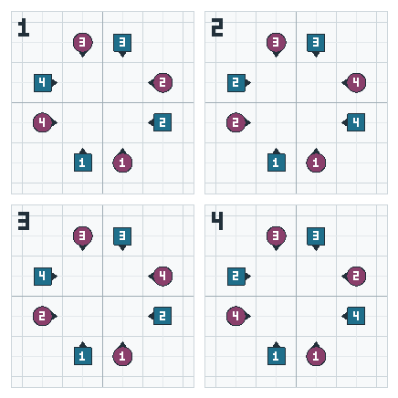

<!-- nav:start -->
**[⏮](../01-start/what-is-square-dancing.md "Previous section: Start here") [◀](arrangements-and-gender.md "Previous page: Arrangements and gender") [☰](../contents.md "Contents") [▶](hands-and-holds.md "Next page: Hands and holds") [⏭](../03-rules/passing-rule.md "Next section: The rules")**
<!-- nav:end -->

# Sequence and relationship

Two squares can look identical from above and still be different. The dancers might be in the right
**positions** but the wrong **order** — and that is the difference between a square that can finish
and one that cannot.

## The circle order

In a squared set, everyone is standing in a ring, and the **couples** come round it in a fixed order:
1, 2, 3, 4.

When the ring still runs in that order — go round it and you meet the couples as 1, 2, 3, 4 — the
square is **in sequence**.

When the couples come round in any other order, the square is **out of sequence**. The positions may
all be filled and the shapes may all be right, but the couples have changed places, and calls will
start behaving strangely.

Callers read it by travelling round the ring **counter-clockwise, starting at the #1 Boy**, and
noting the couple numbers as they pass them: 1, 2, 3, 4 means the Boys are in sequence, 1, 4, 3, 2
means they are out. The same reading is taken for the Girls from the #1 Girl, and the two answers
together give four states:

| State | Boys | Girls |
|---|---|---|
| **1** | in sequence | in sequence |
| **2** | out | out |
| **3** | in sequence | out |
| **4** | out | in sequence |

**Being in sequence does not necessarily mean standing beside your own partner.** The two halves are
read separately and can sit at different points in the ring, so you can be in sequence with your
partner across the square. In states 3 and 4 that is forced — the pairs you see side by side there
are not partners — and even in states 1 and 2 whole couples need not be together.

## Why it matters

A caller who wants to finish the tip neatly has to end with the square **in sequence**, because the
standard finish assumes it. That is what a
[get-out](../01-start/zeroes-getouts-and-modules.md) is for.

For a dancer, the practical consequences are:

- **If you are out of sequence, you may be the odd one out in a call.** Calls that name "the #1 Boy"
  or "your corner" assume the standard order.
- **You can often fix it by finishing the figure.** Most figures are zeroes; dance them out and the
  square comes back.
- **Do not panic about it.** Your caller can see it and will call something that fixes it.

## Relationship

**Relationship** is the local version of the same idea: who is beside you, who is opposite you, who
is your partner and corner *right now*.

A dancer's relationship to the others can change many times in a tip, especially through Allemande
Left, Swing and Promenade, each of which establishes a **new** partner. That is why the manual has
the phrase "current partner" — to distinguish it from your original one.

## In sequence, at home

Put the two together and you get the resting state, the one a tip begins and ends in:

- everyone in their **own position**;
- everyone in **sequence**;
- every couple **Normal**.

Dancers call this **"home, in sequence"**, and the manual names the arrangement a **Squared Set**
(specifically in sequence) as distinct from a **Static Square** (just the arrangement).

## The formal name for all this

Callers and teaching material sometimes refer to the four things that describe a square — the
**Formation**, the **Arrangement**, the **Sequence**, and the **Relationship** — by their initials,
**FASR**.

You do not need the formal framework to dance at Mainstream, and this book does not use it outside
this page. But you will hear "FASR" from a teacher or a caller, and now you know what the four
letters stand for.

## Next

- the arrangement of a couple → [Arrangements and gender](arrangements-and-gender.md)
- coming home on purpose → [Zeroes, get-outs and modules](../01-start/zeroes-getouts-and-modules.md)
